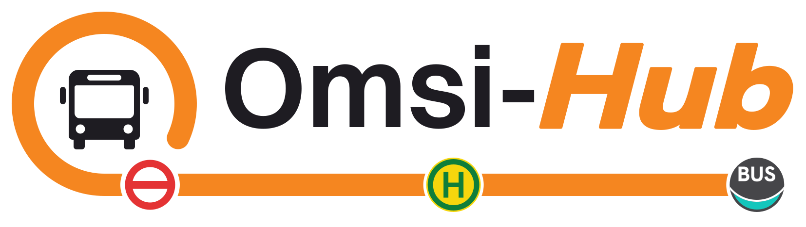

  <picture>
    <source media="(prefers-color-scheme: dark)" srcset="assets/logos/omsi-hub-wordmark-light.svg">
    
  </picture>

  
  
  

**Omsi-Hub** turns the bus simulator into a complete bus operation. It provides a launcher, editors and a full bus company mode: you plan the timetables, the vehicles and the drivers' duties, and you drive the shifts yourself.

Omsi-Hub is built on [openOMSI](https://github.com/openOMSI-org/openOMSI), the open-source recreation of OMSI 2 in Rust.

> [!IMPORTANT]
> **An original copy of OMSI 2 is required.** Omsi-Hub contains no game content of its own. It plays on the maps, vehicles and other files of an installed OMSI 2.

> [!NOTE]
> **Beta software.** Omsi-Hub is in active development. Features may change between versions, and problems can be reported under [Issues](https://github.com/Luc-nbr/omsi-hub/issues).

## Features

- **Launcher.** A single place to start, configure and update the game, with light and dark themes and a choice of accent colour.
- **Ways to play.** Work shift, Tour, Free drive and Bus company.
- **Bus company.** Found a transport company on any installed map:
  - buy, lease or rent vehicles;
  - hire and train staff;
  - win tenders and contracts, or run lines of your own;
  - manage finances, reputation, the depot, the workshop and research.

  It has three game modes (Casual, Normal and Realistic), with an economy based on real operator data.
- **RosterFlow.** Professional-style scheduling and crew rostering: timeplans, vehicle blocks, driver duties, rosters, locks and an optimiser.
- **Operations.** Live service control with incidents, alert thresholds, short-turns and spare vehicles, and a live network map.
- **Editors.** Lines and timetables, liveries and depots.
- **Multiplayer.** Run a company together, with roles and permissions for drivers, dispatchers, managers and co-owners.
- **Optional account.** Friends, invitations, an opt-in leaderboard and two cloud saves. Sign in with email or a Google account. Everything else works without an account.
- **Phone and tablet.** The bus's displays and the duty menu on a device in your own network.

## Download

Releases are published on the [Releases](https://github.com/Luc-nbr/omsi-hub/releases) page. The application updates itself to every new release.

| Platform | File | Start |
| --- | --- | --- |
| Windows x64 | `Omsi-Hub-<version>-windows-x64.zip` | Extract it and run `Omsi-Hub.exe` |
| macOS (Apple silicon / Intel) | `Omsi-Hub-<version>-macos-arm64.dmg` / `-macos-x64.dmg` | Open `Omsi-Hub.app` (the first time: right-click → Open) |

On first start, choose the folder of your OMSI 2 installation.

The Windows release contains three programs:

| Program | Purpose |
| --- | --- |
| `Omsi-Hub.exe` | The application |
| `omsi-hub-game.exe` | The game |
| `omsi-hub-cli.exe` | A command-line tool |

## Website and privacy

- Website: [omsihub.com](https://omsihub.com)
- Privacy Statement: [omsihub.com/privacy.html](https://omsihub.com/privacy.html), source in [`docs/omsihub/PRIVACY.md`](docs/omsihub/PRIVACY.md)
- Contact: info@omsihub.com

## Building from source

Omsi-Hub is a Rust workspace with a Tauri 2 application in `launcher/`. See [BUILDING.md](BUILDING.md) for the requirements and the build steps. The documentation for the Omsi-Hub parts is in [`docs/omsihub/`](docs/omsihub/).

## Credits and licence

Omsi-Hub builds on openOMSI and the work of its contributors. OMSI 2 is a product of MR Software and aerosoft; Omsi-Hub is not affiliated with them.

Licensed under the terms in [LICENSE](LICENSE).
